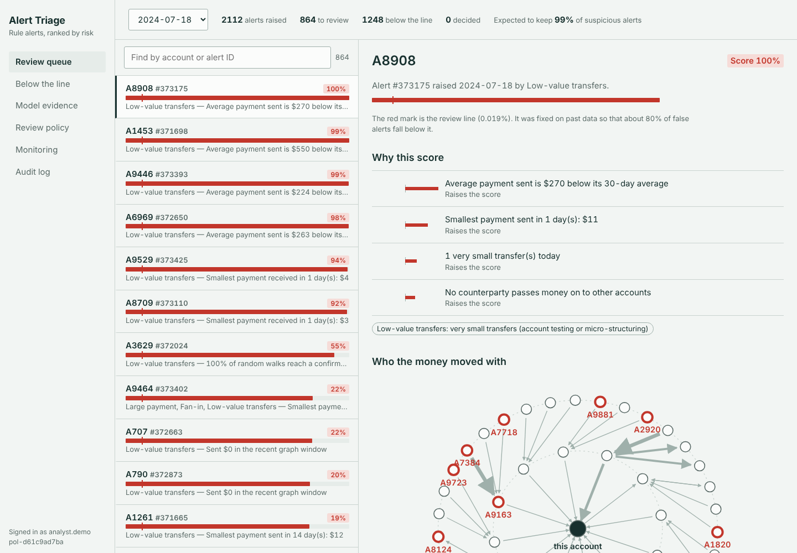
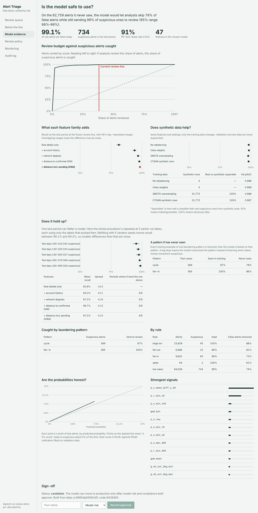
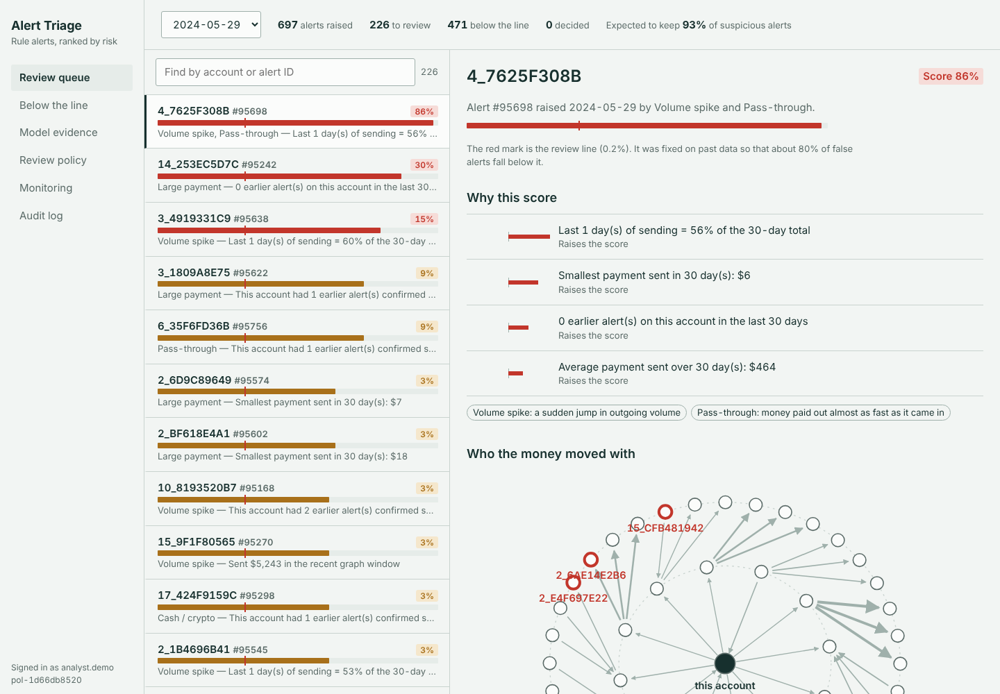
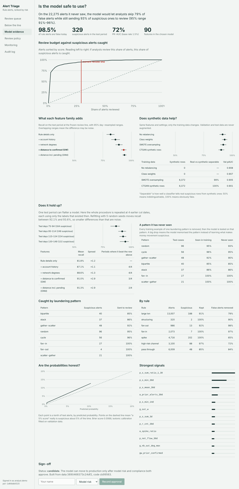
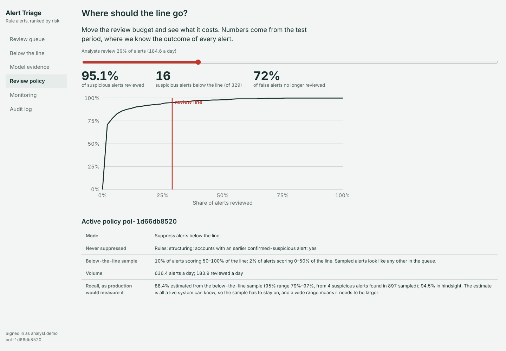
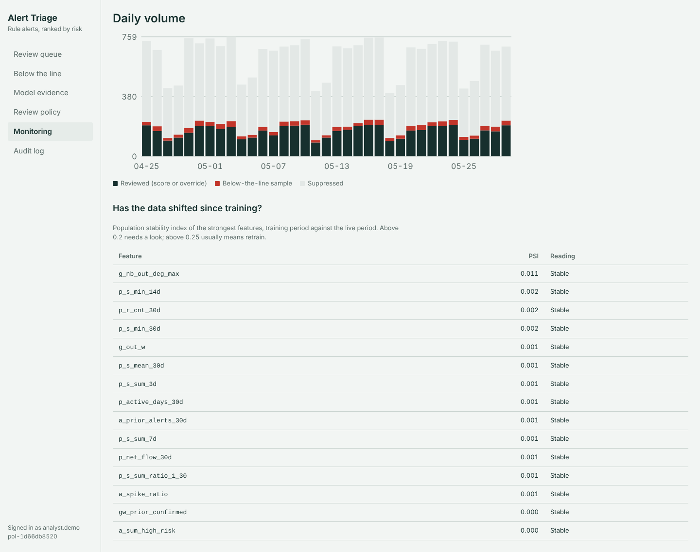

# aml-triage

A triage model for AML transaction-monitoring alerts. The bank's rules keep raising alerts; this model scores each
alert so analysts review the risky ones and the obvious false positives are suppressed, with a blind safety sample
to measure what suppression misses. It ships as a pipeline, an API and an analyst console.

It implements and extends:
- Eddin et al., *Anti-Money Laundering Alert Optimization Using Machine Learning with Graphs*, AAAI 2022
  (profiles, degree features, GuiltyWalker, GuiltyWalker-delay, sliding-window graphs)
- Bakry et al., *Automatic suppression of false positive alerts in AML systems using machine learning*,
  J. Supercomputing 2023 (alert-level features, suppression framing, F-beta)

It replaces an earlier replication (`eddin-fp-reduction`) and fixes its leaks; see `docs/FROM_REPLICATION.md`.

## Results on IBM AMLSim (real public dataset)

IBM AMLSim example (Kaggle `anshankul/ibm-amlsim-example-dataset`): 10,000 accounts, 200 days, 1.32M transfers,
1,719 laundering transfers. The calibrated rule engine raises 373,744 alerts (~1,870 a day); 99.1% are false.
Test period: days 160–199, 82,759 alerts, 734 suspicious. Run `amlsim-20261026T055105Z`; tables in
`reports/amlsim/ablation.md` and `backtest.md`.

| Model features | Suspicious alerts still reviewed | False alerts removed | Mean over 5 backtest periods |
|---|---|---|---|
| Rule details only | 81.3% (79–83) | 80.3% | 81.8% |
| + account history | 94.1% (93–96) | 80.1% | 93.2% (better in 5/5) |
| + network degrees | 97.0% (96–98) | 82.5% | 97.2% (5/5) |
| + GuiltyWalker | 98.0% (97–99) | 81.1% | 96.7% (0/5) |
| + GuiltyWalker-delay (**chosen**) | 98.5% (98–99) | 78.9% | 97.2% (4/5, +0.5 pts) |

- Analysts would review 789 of 2,069 alerts a day instead of all of them; 8 of 734 suspicious alerts fall below the line.
- SMOTE (98.0%) and CTGAN (98.2%) don't beat class weights (98.5%); every synthetic row is separable from real ones.
- **The number to quote is lower.** Remove one laundering pattern from training and recall on it drops: cycle 97% → 79%,
  fan-in 100% → 86%. AMLSim laundering is always under $25, and the strongest features are minimum transfer sizes, so
  the headline partly reflects the simulator's amount signature (see `docs/DECISIONS.md` D15).

| | |
|---|---|
|  |  |

## Results on the synthetic world

Synthetic world: 12,000 accounts, 150 days, ~1M transactions, ~96k rule alerts (98.5% false).
Test period: days 115–149, 22,275 alerts, 329 suspicious. Threshold frozen before the test period.
95% ranges from a day-block bootstrap. Full tables: `reports/synthetic-default/ablation.md` and `backtest.md`.

| Model features | Suspicious alerts still reviewed | False alerts removed | Mean over 4 backtest periods |
|---|---|---|---|
| Rule details only | 81.8% (78–85) | 80.4% | 81.8% |
| + account history (profiles) | 86.0% (82–90) | 80.1% | 87.1% (better in 4/4 periods) |
| + network degrees | 89.1% (86–92) | 78.8% | 88.6% (4/4) |
| + GuiltyWalker, as of alert day (**chosen**) | 93.3% (91–96) | 78.7% | 91.0% (3/4) |
| + GuiltyWalker-delay | 93.9% (92–96) | 79.2% | 91.3% (2/4) |

| Training data (same features) | Recall on test | Real vs synthetic separable |
|---|---|---|
| Class weights (chosen) | 93.3% (91–96) | — |
| No rebalancing | 91.5% (89–94) | — |
| SMOTE oversampling | 92.1% (90–95) | 99.2% |
| CTGAN synthetic rows | 90.3% (88–93) | 100% |

What the evidence says:
- Each feature family from the paper adds recall in most periods; GuiltyWalker-delay adds nothing over GuiltyWalker.
- Synthetic data did not help. A simple classifier tells every CTGAN row from a real one.
- No memorisation: removing every training example of a laundering pattern barely changes recall on it (e.g. cycle 96% → 95%).
- Refitting with 5 seeds moves recall by under 1.5 points; the rolling backtest ranges from 86.6% to 94.7% across periods.
- With the below-the-line sample, production would estimate recall at 88% (95% range 79–97%) against a true 94.5%, while
  analysts review 184 of 636 alerts a day. The wide range says the sample just below the line should be larger.

| | |
|---|---|
|  |  |
|  |  |

## Quick start

Step-by-step for a Mac, with troubleshooting: [`docs/SETUP.md`](docs/SETUP.md). Short version:

```bash
make setup        # python venv (+ CTGAN/torch) and UI packages   (macOS: brew install libomp first)
make doctor       # checks everything and tells you what's missing
make run          # synthetic data in IBM format -> alerts -> features -> models -> scored alerts -> robustness
make ui-build && make serve    # open http://127.0.0.1:8000  (aml-triage serve --run amlsim for the AMLSim run)
```

Real data (see `docs/DATA.md`):
- IBM AMLSim example from Kaggle: `make get-amlsim && make run-amlsim` (rules calibrated on the full file).
- IBM AMLworld HI-Small: put the CSV in `data/raw/`, then `make run-ibm`.

## How it works

```
transactions ──► rule engine ──► alerts ──► features (as-of) ──► LightGBM ──► calibrated score
                                   │            ▲                                  │
                                   └─► labels ──┘ (only decisions already made)     ▼
                                                              policy: overrides · review line · BTL sample
                                                                                   │
                                                              API ──► analyst console ──► audit log
```

| Feature family | Example | Uses labels? |
|---|---|---|
| Alert (`a_`) | which rules fired, payment sizes, prior alerts | no |
| Profiles (`p_`) | sent/received sums, counts, max over 1–30 days, ratios | no |
| Degree (`g_`) | counterparties, neighbours' in/out degree | no |
| GuiltyWalker (`gw_`) | random walks to accounts confirmed suspicious *before* the alert | as-of only |
| GW-delay (`gwd_`) | same, also to pending alerts a stage-1 model flags | as-of + pseudo labels |

## The analyst console

| Screen | For | Shows |
|---|---|---|
| Review queue | analysts | alerts above the line (and blind BTL samples), reasons, counterparty network, payments, decision buttons |
| Below the line | team leads | what was suppressed, for spot checks |
| Model evidence | model risk, compliance | capacity curve, feature-family ladder with CIs, GAN comparison, calibration, per-pattern recall, sign-off |
| Review policy | team leads | slide the review budget, see suspicious alerts caught and missed |
| Monitoring | operations | daily volumes by outcome, feature drift (PSI) |
| Audit log | everyone | every decision with model and policy version |

## Repository map and working agreements

| File | Purpose |
|---|---|
| `CLAUDE.md` | project memory for Claude Code: commands, layout, non-negotiables, gotchas |
| `AGENTS.md` | rules and roles for any coding agent, hand-off protocol, definition of done |
| `docs/ARCHITECTURE.md` | system diagram, time model, stage contracts, feature families |
| `docs/BUILD_PLAN.md` | milestones M0–M10 with acceptance criteria |
| `docs/PROGRESS.md` | what's done, what's next, open questions, dated log |
| `docs/EVALUATION.md` | splits, metrics, CIs, GAN rules, promotion thresholds |
| `docs/REVIEWER.md` | merge checklist (leakage, evaluation honesty, governance, UI) |
| `docs/UI_RULES.md`, `docs/UI_TOKENS.md` | how the console should look, read and behave |
| `docs/DATA.md` | IBM dataset, schema mapping, what the data lacks, the generator |
| `docs/DECISIONS.md` | why things are the way they are |
| `.claude/skills/*/SKILL.md` | repeatable procedures: run-pipeline, leakage-audit, add-feature, evaluate-change, ui-change |
| `.claude/agents/*.md` | subagents: reviewer, leakage-auditor, ml-engineer, ui-engineer |

## Limits worth stating

- Synthetic results show the pipeline works and the paper's direction holds; they say nothing about real laundering.
- IBM AMLworld has no real alerts or analyst decisions; alerts and labels are derived (see `docs/DATA.md`).
- Recall after launch can only be estimated from the below-the-line sample; keep it on.
- Not legal or regulatory advice. Automated alert closure needs your compliance team's and regulator's agreement.
