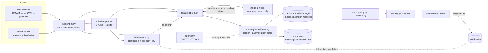

# Architecture

## The system in one picture

## Time model (read this before touching data code)

Every fact has an **event time** and a **knowledge time**.

| Fact | Event time | Knowledge time |
|---|---|---|
| transaction | `day` | `day` (end-of-day batch) |
| alert | `day` | `day` |
| label | `event_day` (the alert's day) | `decision_day` (simulated: lognormal, positives slower) |

A feature for an alert on day *d* may read a fact only if its knowledge time ≤ *d*. The single
implementation of "labels known on day *d*" is `LabelIndex.illicit_mask_as_of(d)`.
`tests/test_point_in_time.py` enforces this end to end by rebuilding the world as it looked on day *d*.

## Stages and contracts

| Stage | Code | Input | Output (in `data/work/<run>/`) | Contract |
|---|---|---|---|---|
| ingest | `pipeline.stage_ingest` | `data/raw/*_Trans.csv`, `*_Patterns.txt` | `transactions.parquet`, `data_meta.json` | `contracts.TRANSACTIONS` |
| alerts | `pipeline.stage_alerts` | transactions | `alerts.parquet`, `labels.parquet`, `alert_stats.json` | `ALERTS`, `LABELS` |
| features | `pipeline.stage_features` | the three above | `features.parquet`, `stage1.joblib` | one row per alert, family prefixes |
| train | `experiment.stage_train` | features | `artifacts/models/<run_id>/`, `reports/<run>/metrics.json` | manifest with data hash + git sha |
| score | `experiment.stage_score` | champion + features | `reports/<run>/scored_alerts.parquet` | policy version on every row |

## Feature families

| Prefix | Family | Reads labels? | Paper |
|---|---|---|---|
| `a_` | rule flags, rule intensities, prior alert count | no | Bakry et al. |
| `p_` | rolling sent/received aggregates over 1–30 day windows, ratios, diffs | no | Eddin §2.2 |
| `g_` | in/out degree, weighted degree, neighbour degree stats | no (window retention reads as-of labels) | Eddin §2.3 |
| `gw_` | GuiltyWalker: walks to accounts confirmed suspicious as of *d*, + prior confirmed count | as-of | Eddin §2.3 |
| `gwd_` | GuiltyWalker-delay: walks to confirmed + pending alerts a stage-1 model flags | as-of + pseudo | Eddin §2.3 |

Graph snapshot per alert day: edges from the last `twl_days` always; edges from the last `tws_days`
only if they touch an account confirmed suspicious as of *d*. The top 1% highest-degree accounts are
removed from the walk graph (merchants and payroll hubs otherwise make every walk "hit"). Walk targets are
accounts confirmed within the last `illicit_memory_days` (60), so the known-bad set doesn't grow forever (see DECISIONS D10).

## Model, threshold, policy

- LightGBM, Optuna-tuned on validation partial AUC (FPR ≤ 0.3); features pruned to 95% of gain.
- Isotonic calibration on validation. Threshold τ fixed on validation at the target FPR (20%), on the raw score.
- `serving/policy.py`: hard overrides → score ≥ τ → stratified BTL sample → suppress. Deterministic hash
  sampling, versioned as `pol-<hash>` of (policy config, τ).
- `serving/reasons.py`: TreeSHAP contributions from LightGBM itself, mapped to sentence templates.

## Serving

FastAPI (`api/app.py`) loads one run's report directory into memory and writes analyst decisions to
SQLite. The React UI (`ui/`) is a static build served by the same process in production, or by Vite
with an `/api` proxy in development. Docker: `docker compose up` builds both.

## Production path (not built yet; see BUILD_PLAN M7–M9)

Replace file stages with orchestrated assets (Dagster), parquet with a lakehouse table format,
SQLite with Postgres, the file registry with MLflow, and feed dispositions back into `labels/` as real
bitemporal labels. The module boundaries above are chosen so each swap touches one package.
